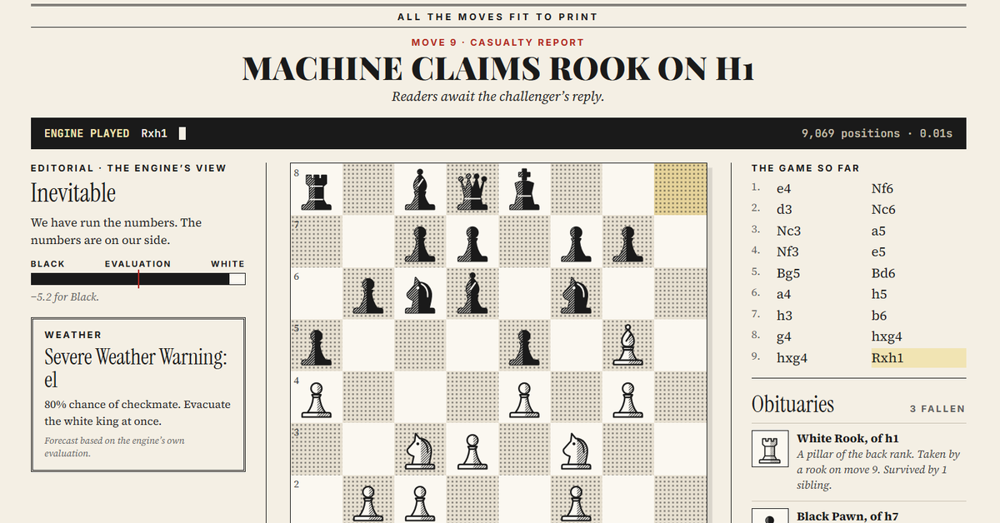

# 🗞️ The Daily Gambit

A chess engine written from scratch in **C++20**, compiled to **WebAssembly**, and dressed up as a newspaper that reports on your game as you play it.

### ▶️ [Play it here](https://chloeroseelia.github.io/Chess-Engine/)



---

## What it does

You play White against the engine. Every move makes the news:

- **Live headlines** written from what actually happened on the board: forks ("KNIGHT FORKS ROYAL FAMILY"), captures, checks, castling, en passant and promotions
- **A ticker** that streams the moves the engine is considering *while it searches*
- **Obituaries** for every captured piece, with its home square, who took it, and how many siblings survive
- **An editorial** in which the engine shares its opinion of the position (it gets smug when it's winning)
- **A weather report** with a checkmate forecast based on the engine's evaluation
- **An EXTRA! edition** at checkmate, stalemate or resignation, with the final position, a tally, an evaluation chart, and your best move and biggest blunder

The pieces are a custom **engraved woodcut** set, drawn as SVG for this project.

---

## Under the hood

**The engine (C++)**
- Legal move generation for every piece, including **castling**, **en passant** and **promotion**
- Check, checkmate and stalemate detection
- **Negamax search with alpha-beta pruning**, three difficulty levels (search depth 2, 3 or 4)
- Evaluation: material plus a bonus for central pieces; mate scores prefer faster mates
- **Standard Algebraic Notation** output (`Nxf7+`, `O-O`, `e8=Q#`) with proper disambiguation
- Search statistics: positions searched, evaluation, and a callback for every move considered

**The web version**
- Compiled to WebAssembly with **Emscripten**; C++ functions exposed to JavaScript through **Embind**
- The engine runs on a **Web Worker** (a background thread), so the page stays smooth while it thinks and can show the search live
- No frameworks: plain HTML, CSS and JavaScript, hosted on GitHub Pages

---

## Project structure

```
├── src/
│   ├── engine.h          # Public interface: Position, Move, search, notation
│   ├── engine.cpp        # Rules, move generation, evaluation, alpha-beta search
│   └── main.cpp          # Terminal version of the game
├── web/
│   └── bindings.cpp      # C++ ↔ JavaScript bridge (Embind)
├── docs/                 # The website (served by GitHub Pages)
│   ├── index.html        # The Daily Gambit: layout, newsroom, EXTRA! edition
│   ├── engine-worker.js  # Runs the engine on a background thread
│   ├── chess.js          # Generated by Emscripten
│   └── chess.wasm        # The engine, compiled to WebAssembly
├── build_web.ps1         # One-command web build (Windows)
└── CMakeLists.txt        # Terminal build
```

---

## Building it yourself

**Terminal version** (CMake + a C++20 compiler):
```
cmake -B build
cmake --build build
```
Then run the `engine` executable and type moves like `e2e4` (promote with `e7e8q`).

**Web version** ([Emscripten](https://emscripten.org) required):
```
em++ -O2 -std=c++20 -Isrc src/engine.cpp web/bindings.cpp -lembind -sMODULARIZE=1 -sEXPORT_NAME=createChessEngine -sALLOW_MEMORY_GROWTH=1 -o docs/chess.js
emrun docs/index.html
```

---

## What's next

- [ ] **Bitboards:** represent the board as 64-bit integers for much faster move generation
- [ ] **Perft testing:** verify move generation against known node counts
- [ ] **Move ordering + transposition table:** search deeper in the same time
- [ ] **Quiescence search:** stop the engine from misjudging positions in the middle of a trade
- [ ] **UCI protocol:** plug the engine into chess GUIs
- [ ] **Opening book**

---

*By Chloe, Chief Engineer* 💕
